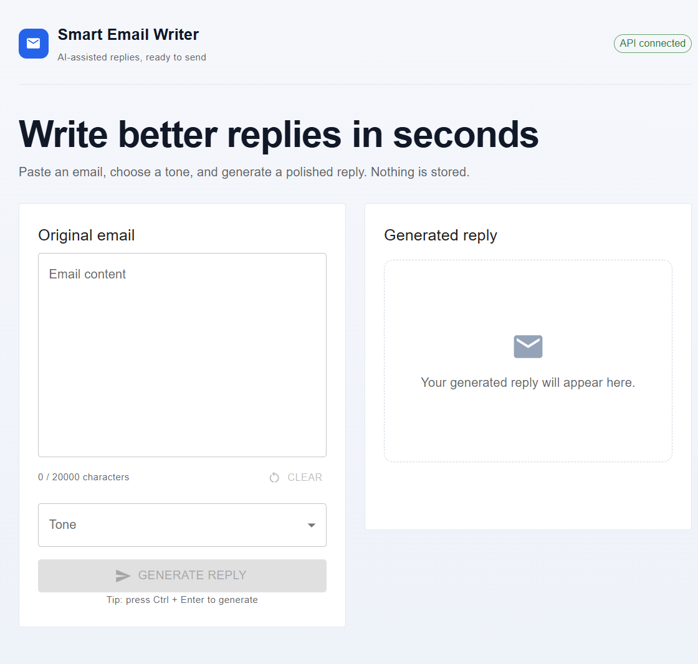
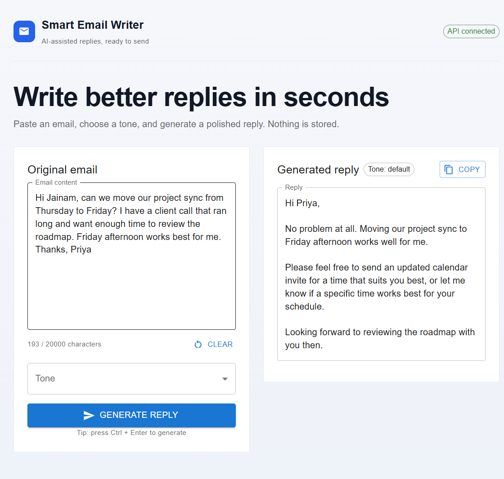
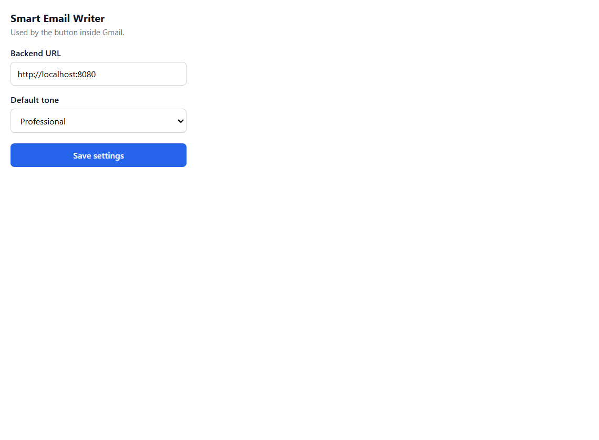

# Smart Email Writer

Smart Email Writer is a full-stack AI assistant that drafts professional email replies from the message you paste (or read in Gmail). It combines a Spring Boot REST API backed by Google Gemini, a clean React workspace, and a Manifest V3 Chrome extension that adds an **AI Reply** button directly to Gmail's compose window.

The app is built for fast local development: one backend command, one frontend command, and one "Load unpacked" step for the extension.

## Features

- Generate a reply from any email text with a single click (`Ctrl + Enter` in the web UI).
- Choose a tone: professional, friendly, casual, assertive, empathetic or concise.
- Copy the generated reply to the clipboard.
- Inline API health indicator and clear error messages when the backend is offline or the API key is missing.
- Gmail extension injects an **AI Reply** button into the compose toolbar and inserts the reply into the compose box.
- Extension settings popup for backend URL and default tone (stored in `chrome.storage.sync`).
- Validated requests, structured JSON errors, request timeouts, and 11 backend tests.
- Tone selection is applied explicitly in the Gemini prompt, with a visible tone badge and stale-reply protection in the UI.
- Copy uses the Clipboard API with an automatic fallback when the browser blocks it.

## Screenshots

Captured from the app running locally (backend on `:8080`, Vite on `:5173`).

**Web UI — empty state**



**Web UI — generated reply**



**Gmail extension — settings popup**



## Tech stack

| Layer | Technology |
| --- | --- |
| Backend | Java 21, Spring Boot 3.4, Spring WebFlux `WebClient`, Bean Validation, Maven wrapper |
| AI | Google Gemini `generateContent` REST API |
| Frontend | React 18, Vite 6, Material UI 6, Axios |
| Extension | Chrome Manifest V3, content script, service worker, popup |
| Config | `.env.example` files, environment variables |

## Project structure

```
smart-email-writer/
├── backend/            Spring Boot API (POST /api/email/generate)
│   └── src/main/java/com/smartemail/writer
├── frontend/           React + Vite web UI
│   └── src/api/emailApi.js
├── chrome-extension/   Gmail "AI Reply" extension
└── docs/screenshots/   Images used in this README
```

## Quick start

### Prerequisites

- JDK 21
- Node.js 18+ and npm
- Google Chrome
- Gemini API key: <https://aistudio.google.com/app/apikey>

### 1. Backend

```powershell
cd backend
Copy-Item .env.example .env
notepad .env              # set GEMINI_API_KEY
.\mvnw.cmd spring-boot:run
```

Runs on `http://localhost:8080`. Verify with:

```powershell
Invoke-RestMethod http://localhost:8080/api/email/health
```

### 2. Frontend

In a second terminal:

```powershell
cd frontend
npm install
npm run dev
```

Open `http://localhost:5173`.

### 3. Gmail extension

1. Keep the backend running.
2. Open `chrome://extensions`, enable **Developer mode**.
3. Click **Load unpacked** and select `D:\smart-email-writer\chrome-extension`.
4. Optional: click the extension icon to change backend URL or tone.
5. Open Gmail → **Compose** → click **AI Reply**.

See `chrome-extension\README.md` for details and troubleshooting.

## API

| Method | URL | Purpose |
| --- | --- | --- |
| `POST` | `/api/email/generate` | Generate a reply from `emailContent` and optional `tone` |
| `GET` | `/api/email/health` | Liveness check |

```bash
curl -X POST http://localhost:8080/api/email/generate \
  -H "Content-Type: application/json" \
  -d '{"emailContent":"Hi, can we move the meeting to Friday?","tone":"friendly"}'
```

Success: plain text reply body (no subject line).

Error: JSON such as
```json
{"message":"GEMINI_API_KEY is not configured.","detail":"Check GEMINI_API_KEY and the configured model URL.","timestamp":"2026-11-21T05:44:17Z"}
```

## Configuration

Backend (`backend\.env.example`):

| Variable | Default | Notes |
| --- | --- | --- |
| `GEMINI_API_KEY` | empty | Required for generation |
| `GEMINI_API_URL` | Gemini 3.6 Flash `generateContent` endpoint | Key is appended automatically |
| `PORT` | `8080` | Server port |
| `CORS_ALLOWED_ORIGINS` | Vite dev origins | Comma-separated origins |
| `GEMINI_CONNECT_TIMEOUT_MS` / `GEMINI_RESPONSE_TIMEOUT_MS` | `5000` / `60000` | HTTP timeouts |

Frontend (`frontend\.env.example`):

| Variable | Default |
| --- | --- |
| `VITE_API_BASE_URL` | `http://localhost:8080` |

## Tests and checks

```powershell
cd backend
.\mvnw.cmd test        # 11 tests: controller, validation, prompt/tone, service, error paths

cd ..\frontend
npm run build          # production bundle
npm run lint           # ESLint
```

## Troubleshooting

- **"GEMINI_API_KEY is not configured"** — add the key to `backend\.env` and restart the backend.
- **"API offline" / "Cannot reach the backend"** — make sure the backend is running and the URL matches.
- **CORS error** — add your frontend origin to `CORS_ALLOWED_ORIGINS` and restart.
- **"Copy was blocked by the browser"** — if both copy methods are denied, the reply text is selected automatically; press `Ctrl + C`.
- **Same reply for a different tone** — change the tone and generate again; changing the tone clears the stale reply, and the badge next to "Generated reply" shows which tone produced it.
- **No AI Reply button** — reload the extension and hard-refresh Gmail.
- **Java release error** — use JDK 21.

## Acknowledgment

This project is a refined, standalone implementation of the Email Writer tutorial from the EmbarkX *Spring AI Masters* repository. The original idea and tutorial are credited to EmbarkX; the code here has been restructured, rebranded and extended with validation, tests, configuration, a redesigned UI and a Chrome extension settings flow.

## License

For personal and portfolio use.
